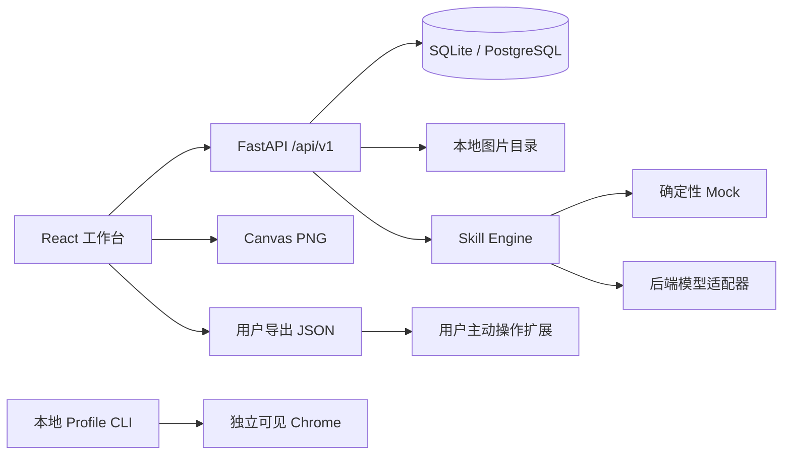

# 架构与运行方式

React 19 + TypeScript + Vite + Tailwind 4；基于 Radix Slot、CVA 的 shadcn 风格 Button。TanStack Query 管理服务端缓存；Zustand 只保存当前选择、toast 和内存令牌，不持久化业务数据。React Router；Markdown 编辑与 react-markdown 安全预览；Canvas 输出封面 PNG。

FastAPI + Pydantic + SQLAlchemy；SQLite WAL + 外键；Alembic 迁移。单进程开发即可完整运行，无 Redis、消息队列或独立 AI 服务。数据库 URL 支持 PostgreSQL+psycopg，未进行 PostgreSQL 集成验收。

发布适配边界：当前 ManualPublisher 的复制、导出、打开官方页面与人工记录实际可用。BrowserAssistPublisher 采用 JSON 导出 + 最小权限扩展，不自动填写平台 DOM。OfficialPublisher 未授权，保持不可用。没有服务器远程启动 Chrome 的路径。

离线原型复用 App、CSS、组件，通过专用本地数据适配器替换 fetch，采用 HashRouter；它只属于 `prototype/index.html`，不会进入正式入口。原型的 JSON、图片 data URL 在 localStorage；正式页面只经 API 持久化。

主要取舍：成熟 Markdown 输入替代 TipTap；当前文件存储不实现 S3；单用户先行，不添加虚假的团队权限界面；提醒在工作台打开时展示，不实现后台调度和推送。全部在已知限制中明确。
