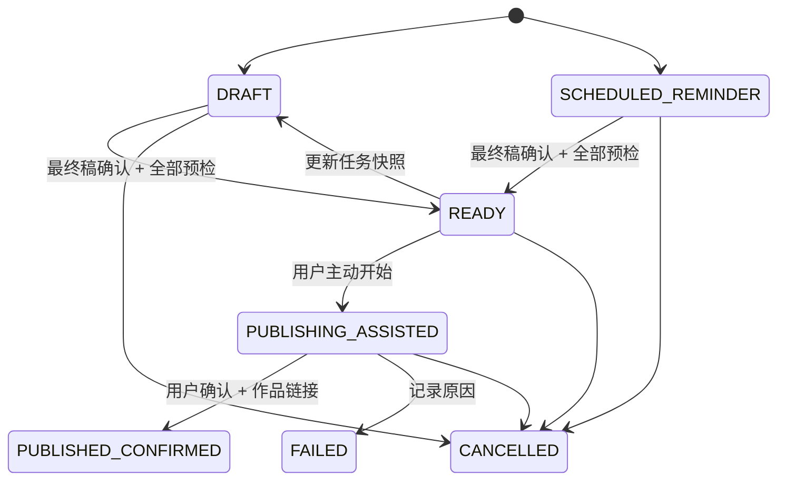

# 发布状态与平台边界

预检：标题正文完整；有封面或素材；账号已获授权；任务快照/账号与当前稿件一致；当前规则下风险复核完成；字数符合可配置编辑规则；用户确认最终稿及素材权利。开始人工发布时再次验证，避免 READY 后修改绕过预检。

确认只接受 HTTPS 的 xiaohongshu.com / www.xiaohongshu.com 的 explore、discovery/item 24 位笔记 ID，或 xhslink.com 的分享路径。拒绝用户信息、非预期域名、其他协议和端口。存储时移除查询参数，避免保留链接中的分享令牌。数据库限制同任务、同工作区作品链接重复确认。

记录证据显示“用户人工确认，未向平台验证”。链接语法与用户声明不能证明平台真实存在该笔记；服务器不会假装获得发布回执。测试中的合成链接只能用于隔离数据库，不能在演示主库标为真实作品。

ManualPublisher 可用；BrowserAssistPublisher 只提供资料转交和用户触发的辅助；OfficialPublisher 未实现，未获授权。不得使用未公开接口、Cookie 抓取、指纹伪装、验证码绕过、自动互动或隐形批量浏览器。

定时提醒以 UTC 存储、界面按用户本地时区显示。没有定时自动发布、后台推送或操作系统通知；工作台打开后显示到期提示，周历可以查看任务。之后可在不改变人工提交边界的前提下增加合法通知。
